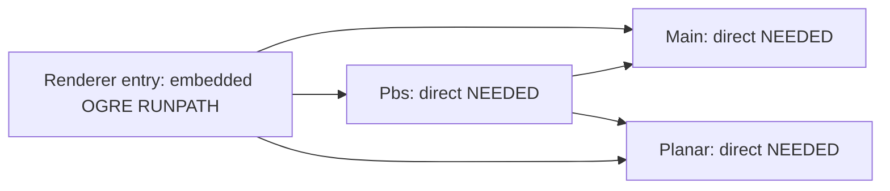

# Target-bearing loader context production research

The retained failure is caused by applying independent-entry checks to historical mapped leaf candidates. `runtime_catalog` appends runtime:dependencies to roots; sorted standalone HlmsPbs was checked without its renderer entry context. New current ELF metadata shows the installed renderer directly needs the same two sibling libraries and has an OGRE RUNPATH. The next producer design uses actual entry dependency traces and still hashes every candidate leaf. No production change/final freeze/physical source or calibration result is claimed by this research.

## Evidence and reasoning

The unchanged consumed v1 retains86 ldd calls: the final HlmsPbs call used only PATH=/usr/bin:/bin and LANG=C.UTF-8, returned0 with two names unresolved, and the preparer exited1. Its actual12 SDK queries/45 input files/14Agent deployed names/resource facts/source snapshots and failed scope are not rerun, edited or overwritten. The old candidate inventory included both matching paths.

One necessary readonly metadata observation ran six bounded `readelf -d` calls, each exit0, input SHA/size/device/inode/time before/after unchanged, no captured output limit exceeded. Current Main/Planar/HlmsPbs files exist. Root libgz-rendering8-ogre2.so.8.2.3 has RUNPATH /usr/lib/x86_64-linux-gnu/OGRE-2.3 and direct NEEDED Main/Pbs/Unlit/Overlay/Planar; Pbs has no RPATH/RUNPATH and needs Planar/Main. This later file presence is not backfilled into the earlier v1 execution. No ldd, SDK, dlopen/ctypes/native extension import, renderer, engine, PX4, Agent, compiler, consumer or sensors were run here. Python/readelf/dpkg themselves are native programs; the original observer's `native_libraries_loaded=false` is scoped by the additive metadata addendum to deliberately loading selected Gz/OGRE targets, not all interpreter libraries or process-maps closure.

Fixed Gz rendering source finds an engine plugin path and passes that entry path to Gz Loader. The pinned loader chooses RTLD_LAZY|RTLD_LOCAL (optional NODELETE), not global symbol loading. [Rendering manager](https://raw.githubusercontent.com/gazebosim/gz-rendering/f1249da6e07f0d6b7adaba28109fa7af727fd322/src/RenderEngineManager.cc), [plugin loader](https://raw.githubusercontent.com/gazebosim/gz-plugin/4fc5ab140242f3126aeb4e2e6fb578d36e04a80f/loader/src/Loader.cc). Its CMake sets the renderer target's installation path from OGRE library directories; the actual ELF confirms embedded RUNPATH rather than a new environment override. [CMake](https://raw.githubusercontent.com/gazebosim/gz-rendering/f1249da6e07f0d6b7adaba28109fa7af727fd322/ogre2/src/CMakeLists.txt)

The fixed glibc loader searches already mapped SONAMEs before new lookup and applies the requesting object's RUNPATH. Its dependency collector builds an ordered breadth-first list, so the renderer's direct Main and Planar dependencies can be mapped before Pbs child resolution. These source rules and actual ELF tags explain the standalone-vs-entry difference; they are an inference about the expected entry behavior, not an actual successful load/trace on this machine. RUNPATH is not claimed to propagate into grandchildren. [dl-load](https://raw.githubusercontent.com/bminor/glibc/ef321e23c20eebc6d6fb4044425c00e6df27b05f/elf/dl-load.c), [dl-deps](https://raw.githubusercontent.com/bminor/glibc/ef321e23c20eebc6d6fb4044425c00e6df27b05f/elf/dl-deps.c).

The diagram is declared ELF dependency structure, not measured runtime state. Global LD/RPATH edits would change the capture search space; dropping leaves would lose input identity/coverage. The new design instead keeps every candidate file and only invokes dependency tracing at explicit actual entry contexts, requiring complete renderer coverage of the three known OGRE files. Candidate-only remains a separate unverified-mapping category. Future mapping phases catch undeclared/changed libs; neither initial trace nor a file baseline proves all dlopen/driver/shader/continuous closure.

## Fixed primary source and installed provenance

Official full untruncated Git trees and each selected original blob/size/SHA are retained: gz-rendering tag8.2.3 commitf1249da6e07f0d6b7adaba28109fa7af727fd322/tree1478; gz-plugin2.0.4 commit4fc5ab140242f3126aeb4e2e6fb578d36e04a80f/tree245; Ogre-next2.3.1 commite4c5f0f6d36c07af594e3ef143d017bda1581442/tree6025; glibc2.39 commitef321e23c20eebc6d6fb4044425c00e6df27b05f/tree20266. Thirteen original source/license files are retained; the final inventory checks that count. Ogre root LICENSE and plugin loader/src/detail/Loader.cc are absent in those exact trees; those observations remain. Ogre's actual COPYING was subsequently fetched and original blob-checked, retaining its MIT terms. Gz Apache2.0 and glibc COPYING/COPYING.LIB (GPL/LGPL) remain complete. Sources were downloaded/read only, never installed/imported/compiled.

Installed metadata separately reports libc2.39-0ubuntu8.9, Gz rendering8.2.3-1~noble/plugin2.0.4-1~noble, OGRE package libogre-next-2.3.0 version2.3.1-9osrf~noble, binutils2.42-4ubuntu2.8/readelf2.42. Original query used nonexistent spelling libogre-next-2.3.1 and returned1; this is not an absence conclusion. Initial dpkg-S on /lib alias also returned1 for that path; the later resolved /usr/lib/...loader.so.2.0.4 ownership query returned0. Both first partial queries and later timed observations remain. Five installed package copyright files are retained separately from the fixed upstream root licenses. No whole transitive licensing, distro patch/build matching, mapped-memory/source authentication or toolchain certification follows. Readelf binary SHA/version were observed only afterward, not retrospectively pre-attested.

## Scope, resources and prospective work

Single initial Win1169866752/WSL7049236480B observation had no classified competition and Docker0/empty; original2GiB false and4GiB physical still unavailable. No resource gate polling/retry or heavy dispatch was done. Readonly metadata uses actual10s readelf/2s kill-after,13s inner Python wait and30s Windows outer; <=2MiB per captured stream was checked after collection, not claimed as a certified peak/hard capture-memory limiter. No cgroup memory budget or system/aggregate peak was measured for this metadata command.

New design/plan specify fresh dual1GiB512MiB/swap0/CPU100/tasks64/210scope180inner240outer for one future static-v2 attempt, same original independent preparation budget. A new literal v2 producer/study is required before any entry trace/SDK graph; oldv1 cannot be rerun. Original dual4GiB physical/full learning/firmware and dual2GiB PNG budgets, original workloads and all eight false qualifications remain. Old EGOv3/cachedOpenVINS/target detector attempts are CONSUMED.

Task1 new entry-bill production implementation, Task2 v2 graph/study integration, Task3 actual static freeze and Task4 physical use are all prospective/pending. No new product module, test, physics, training or native consumer result is claimed. This phase completes the failure investigation and concrete production architecture/implementation plan; it does not complete raw measurement. Evidence seal/publication is separate, preserves original source/failure/archive bytes and distinguishes prepublication plan from later publication-only records.

## Additive clock-domain limitation

The retained Windows end_utc precedes the first WSL row start_utc. These are separate wall-clock domains without synchronization evidence; they cannot establish elapsed duration or strict cross-host nesting. Original timestamps remain unchanged. Per-command exit/output and stable file identities support metadata observations only. Future actual v2 budget records must include per-clock monotonic elapsed facts. This is a reviewed evidence limitation, not a new native failure or permission request.

## Publication scope

The full initial unclassified process-name/PID inventory is preserved locally and remains unpublished. The evidence package contains only its SHA/size and a classified derivative with original counters, process counts, empty competition and Docker result; no raw observation is rerun or deleted. Full historical instructions are preserved exactly in evidence/flydrones-history-through-admitted-executor-dev-1701.json, separate from new findings, so automation size management cannot discard earlier failure/safety history.
